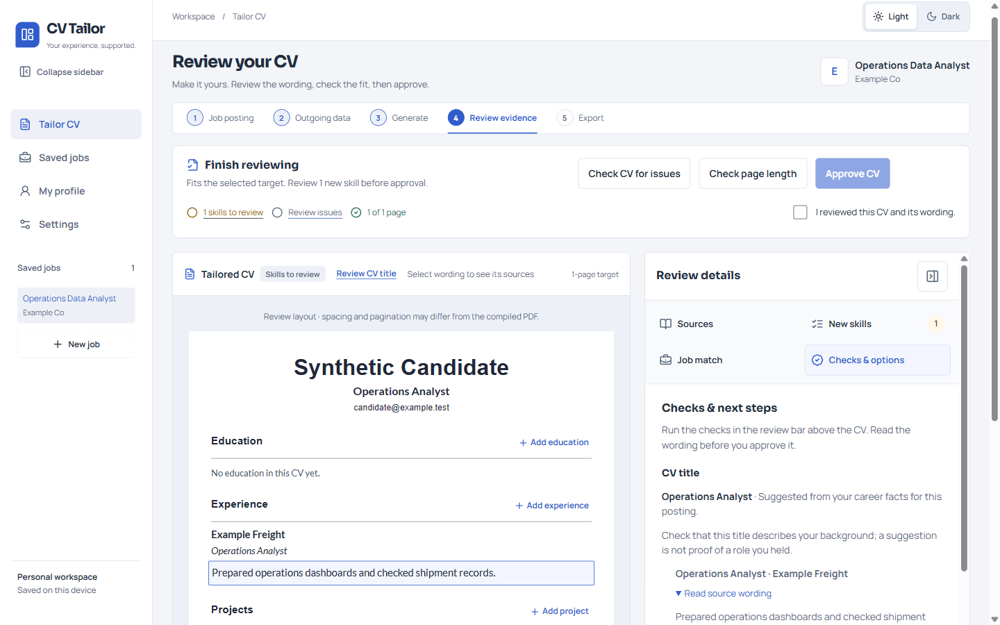
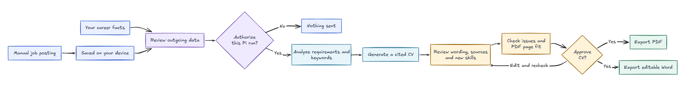

# CV Tailor

A Windows desktop workbench for turning your own career facts and a manually saved job posting into a tailored CV you can inspect before exporting. Profile and job records stay in your local workspace; model work uses your chosen Pi provider **only after you review the outgoing text and authorize that run**. The app does not fetch job postings or guarantee an ATS or hiring outcome.



*Screenshot of the real development app with a fictional, scripted test fixture. No personal CV or live provider result is shown.*

## Get started on Windows

**Direct download:** [CV-Tailor-Setup-0.1.0.exe](https://github.com/MakCoder-2004/ATS-CV-Creator/releases/download/v0.1.0/CV-Tailor-Setup-0.1.0.exe) (Windows). [Release details and checksum](https://github.com/MakCoder-2004/ATS-CV-Creator/releases/tag/v0.1.0).

The updated v0.1.0 prerelease installer is **unsigned**. Its verified SHA-256 is `87eda85f18f16a6a62658e8ed2de805232b90071a4f0993db44e7442ae2bec27`; it replaces different bytes previously published under the **same version and filename**. Check the digest if your download may be cached. The new binary passed build checks and an installed-app smoke: an isolated SQLite workspace reopened and its bundled compiler produced a selectable PDF with the CV title. Real-provider quality and installed Word export remain unverified. Windows may warn about an unknown publisher. Version 0.1.0 resets numbering from 0.6.2; do not assume an automatic upgrade. Back up your workspace and exported files before replacing one.

1. **My profile:** enter your contact details, education, experience, projects and skills. You can also upload a text PDF or DOCX, inspect proposed facts and apply only those you accept; a local import route remains available without Pi.
2. **Saved jobs:** enter a job title, company and the complete posting text. Optional contacts are entered by you, not discovered or sent to a model. Jobs are saved on this device; there is no job URL fetch or “Open original” action.
3. **Settings:** choose an exact Pi provider/model reference and thinking level. Sign in through Pi outside CV Tailor; the app does not store an in-app Pi key or standing model consent.
4. **Tailor CV:** follow **Job posting → Outgoing data → Generate → Review evidence → Export**. Inspect the minimized text and its destination, then authorize the run before analysis. Review the posting's requirements before choosing **Generate tailored draft**.
5. **Review evidence:** inspect an optional AI-suggested professional title beneath your name, edit or remove it, and select wording to see its linked career source and why it appears. Decide whether each posting-only skill is truly yours or remove it. Edit the CV, check issues, measure the actual PDF page fit, acknowledge the wording and explicitly approve. The sticky bar keeps those actions within reach; Review details opens on demand when the document needs the width.
6. **Export:** inspect the compiled PDF preview, then save a selectable PDF or editable Word document. PDF is authoritative; Word may reflow. Review-only source notes and pending skill annotations do not enter the exported document.

Checks can miss factual errors. Review the wording and citations yourself. When a model run is authorized, the selected provider receives the reviewed, minimized posting/profile text; local storage does not imply that provider processing stays on your device. See [implemented workflows](docs/workflows.md) for behavior and limitations.

## How it is made



[Open the full-size workflow diagram](docs/images/job-posting-workflow.png).

This diagram shows the user workflow. Under the hood, a React and TypeScript renderer calls named, validated methods through an isolated Electron preload bridge. Trusted main-process IPC owns native SQLite, authorized Pi SDK and LangGraph requests, and bundled pdfLaTeX and DOCX export. The renderer has no direct filesystem or Node access. The model proposes content; it does not write executable LaTeX or approve a CV. See [architecture](docs/architecture.md) for process boundaries, [the glossary](GLOSSARY.md) for domain language and [development checks](docs/development.md) for build and validation.

## Design system

The [normative design system](design%20system/README.md) defines the page contracts, semantic light/dark tokens and interaction rules. Tailor CV and Saved jobs use the approved **Variant A Workbench** shell; My profile and Settings retain their existing structure. The UI uses Manrope with Sora headings. Review keeps a white Letter-proportioned Lato CV at readable width, a sticky action bar and a contextual source/decision panel that becomes a requested dialog when space is limited. The structured Review paper is not exact PDF pagination; Export shows the compiled PDF. The [browser-only prototype](prototypes/cv-tailor-ui/README.md) and [Review gallery](prototypes/review-evidence-gallery/README.md) are design evidence, not production behavior.

## Build from source

On Windows with Node/npm:

```bash
npm ci
npm run prepare:latex   # Provision pinned local pdfLaTeX for PDF checks/builds
npm run typecheck
npm test                # Rebuild native SQLite for Node; run Vitest
npm run test:electron   # Rebuild native SQLite for Electron; run Playwright
npm run dist:win        # Verify and build an NSIS installer in release/
```

Node and Electron use different SQLite native ABIs; run their checks in that order rather than concurrently. The compiler is bundled into the installer, so end users do not need a separate TeX installation. [The updated 0.1.0 build record](docs/validation/release-0.1.0-title-replacement.md) identifies the current installer bytes; the [installed-app check](docs/validation/release-0.1.0-title-installed.md) records SQLite reopen and a synthetic compiled-PDF title. The [original build](docs/validation/release-0.1.0-candidate.md) and [earlier installed-app check](docs/validation/release-0.1.0-installed.md) apply to the superseded bytes.

## Rights and release status

The application is marked **UNLICENSED**: public source visibility does not grant permission to reuse or redistribute this project's code. Third-party components carry their own terms. The [Pi notices](resources/licenses/README.md) and [LaTeX inventory](resources/latex-licenses/README.md) are incomplete as a public redistribution review; the unsigned prerelease is not a claim of licensing clearance or a complete installed-workflow acceptance. Do not redistribute the installer without reviewing its included notices and applicable obligations.
