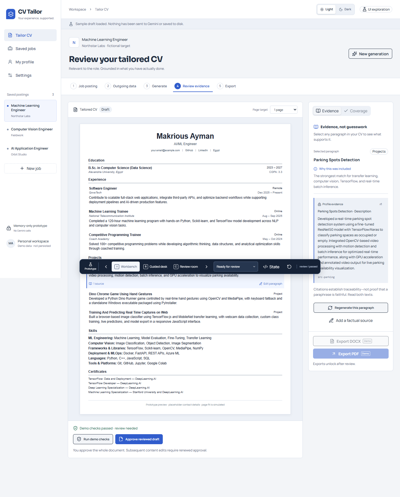
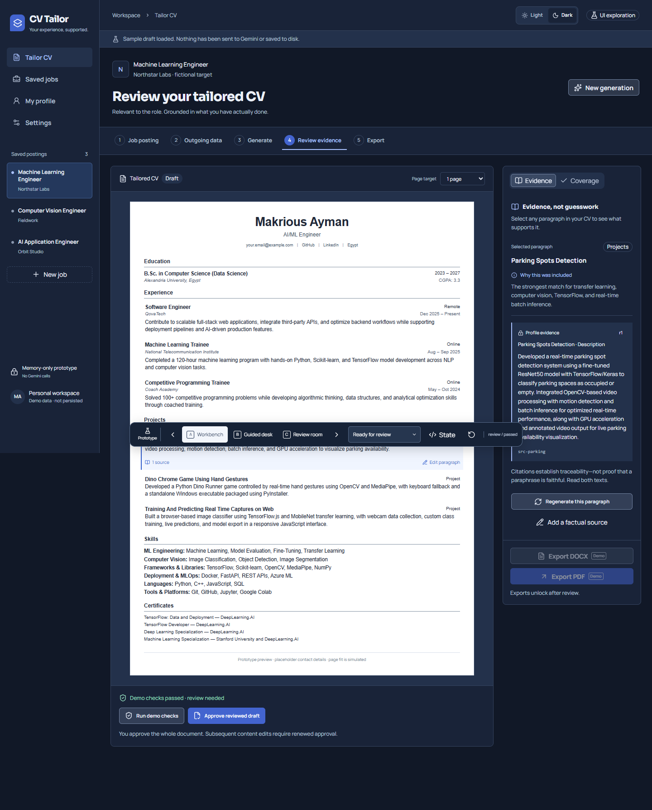
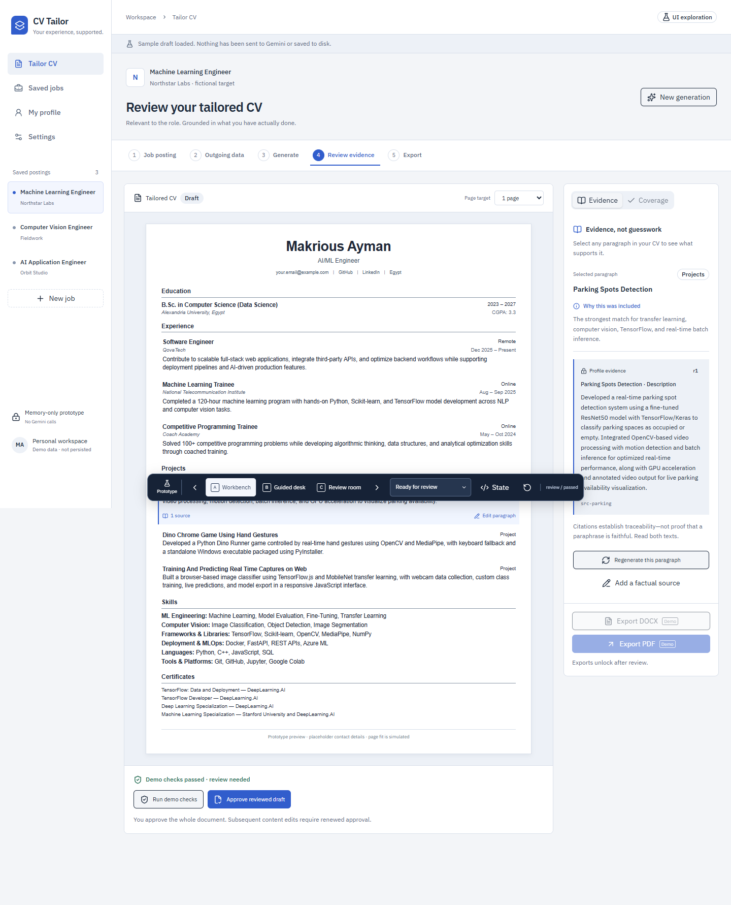
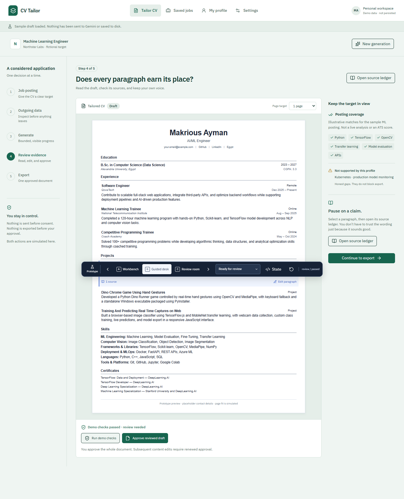
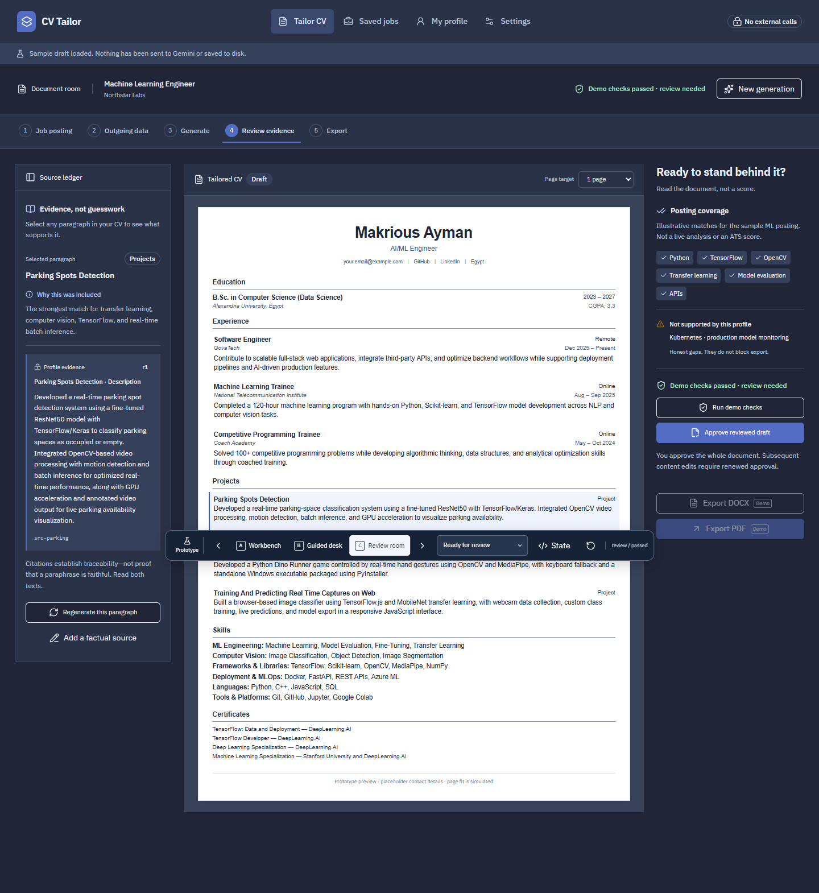
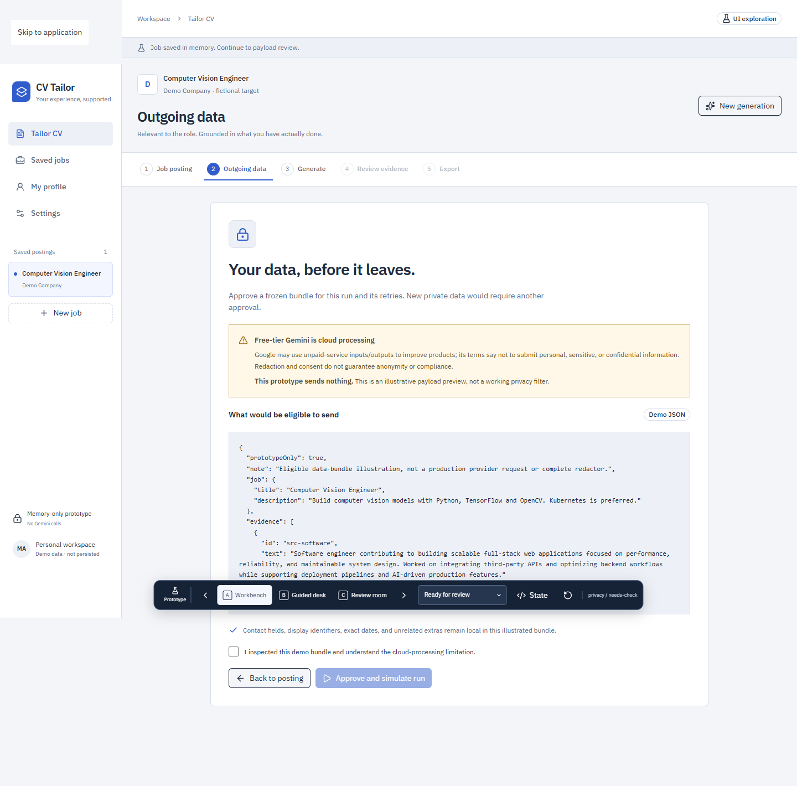
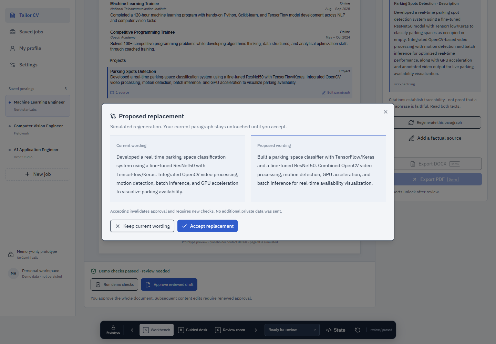
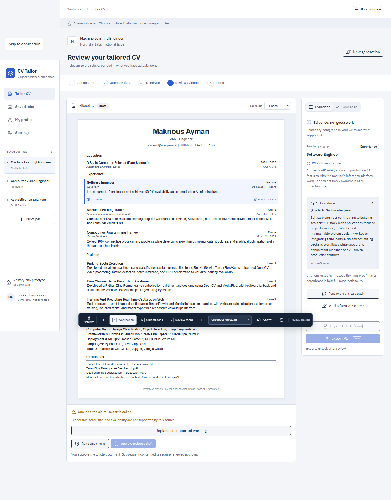

# Prototype screenshots

Captured with Playwright-driven Microsoft Edge, reduced motion enabled. Desktop viewport: 1440 × 1000 CSS pixels; narrow viewport: 390 × 1000. Full-page images extend below the viewport. The floating development comparison bar is intentionally visible. The user explicitly approved A — Workbench with its refined light/dark modes and Sora/Manrope typography. Earlier captures remain as historical exploration, not alternative production designs.

## Current refinement — A Workbench

Same preferred layout, with Sora headings and Manrope interface text. App appearance changes; the white Arial CV does not.

### Light

### Dark

Additional refinement captures:
- [Light, 390px](screenshots/A-light-narrow.png)
- [Dark, 390px](screenshots/A-dark-narrow.png)
- [Dark settings](screenshots/A-dark-settings.png)
- [Dark payload consent](screenshots/A-dark-consent.png)
- [Dark regeneration diff](screenshots/A-dark-diff.png)

## Original A — Workbench exploration

Persistent saved-job navigation, paper editor, evidence inspector. Historical typography before the requested refinement.

## B — Guided desk

Stage rail, focused review, source ledger opened on demand.

## C — Review room

Document-first room between source ledger and qualification gaps.

## Important workflow states

### Inspect and approve the eligible outgoing bundle

### Review a regeneration proposal before replacement

### Unsupported claims block export, unlike qualification gaps

## Narrow layouts

- [A — Workbench, 390px](screenshots/A-narrow.png)
- [B — Guided desk, 390px](screenshots/B-narrow.png)
- [C — Review room, 390px](screenshots/C-narrow.png)

## Feedback

A’s layout, light/dark modes and Sora/Manrope typography are approved, as recorded in [FEEDBACK.md](FEEDBACK.md). Carry this visual direction into `/to-spec`. Detailed workflow validation remains separate from this design approval.
